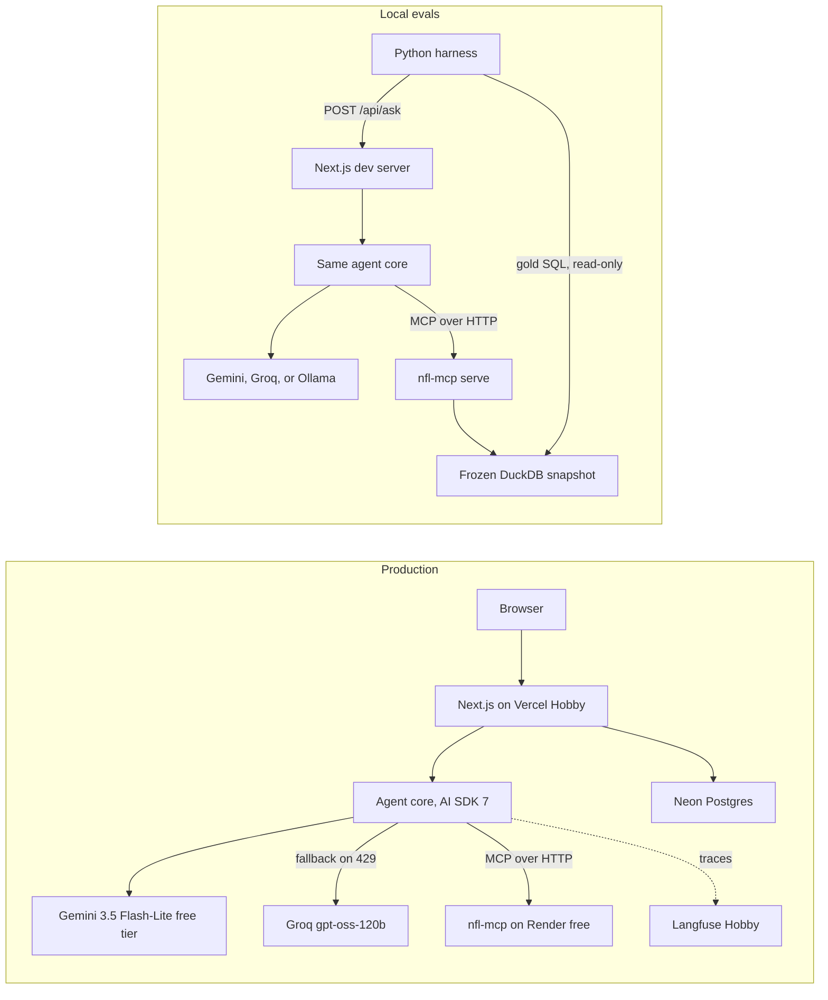

# NFL Stats Agent: build plan

Repo: [github.com/ephaas/nfl-stats-agent](https://github.com/ephaas/nfl-stats-agent). Before I start: rename `~/Desktop/NFL-stats-agent`  (trailing space) to `~/Desktop/nfl-stats-agent` and reopen it in Cursor. Then I `git init`, point it at that repo, save this as `PLAN.md`, and create `AGENTS.md`, `.gitignore`, and `.env.example`.

## 1. Goal and success metrics

- **Goal:** plain-English NFL questions answered by computing from nflverse play-by-play through nfl-mcp. Every answer shows its SQL, tool calls, a result table, an optional chart, and a trace.
- **Headline:** a frozen 70-question test set comparing plain chatbot vs. SQL-only agent vs. curated-tools agent, for Gemini 3.5 Flash-Lite, gpt-oss-120b, and qwen3, with paired 95% confidence intervals.
- **Targets:** the curated agent beats the plain chatbot with a confidence interval that excludes zero. At least 95% of agent answers are fully faithful (every number appears in a tool output). Abstention recall is at least 0.8. The live demo costs $0.

## 2. Facts I checked (Oct 12–13, 2026)

Things that contradict or update the brief:

- **Workspace path.** Cursor's path `~/Desktop/NFL stats agent` doesn't exist; the real folder has a trailing space. You'll rename it to `~/Desktop/nfl-stats-agent`.
- **Your Mac.** It has 36 GB of RAM, not 32. Only `qwen3:8b` is pulled; `[qwen3.8:27b](https://ollama.com/library/qwen3.8)` exists (18 GB at Q4_K_M, plus an MLX build) but isn't downloaded yet. Docker and the `gh` CLI aren't installed. You have Node 22.15.1, uv 0.12.24, and Ollama 0.40.2.
- **AI SDK version.** It's now v7: `ai` 7.0.138, `@ai-sdk/mcp` 2.0.74, `@ai-sdk/google` 4.0.94, `@ai-sdk/groq` 4.0.60. It's ESM-only and needs Node 22 or newer. The [migration guide](https://ai-sdk.dev/docs/migration-guides/migration-guide-7-0) lists the renames that affect us:
  - `system` became `instructions`
  - `stepCountIs` became `isStepCount`
  - `onFinish` became `onEnd`
  - `experimental_telemetry` became `telemetry`
  `[createMCPClient` with `transport: { type: 'http' }](https://ai-sdk.dev/docs/ai-sdk-core/mcp-tools)` is confirmed. The mock model for tests is `MockLanguageModelV4` from `ai/test`.
- **TypeScript.** npm's `latest` is 7.0.2 (the native-compiler rewrite), but the template for Next 16.4.0 pins `typescript ^5`. We stay on 5.x.
- **Gemini free tier.** [Free models](https://ai.google.dev/gemini-api/docs/pricing) include `gemini-3.8-flash`, `gemini-3.6-flash`, `gemini-3.5-flash-lite`, and `gemini-3.1-flash-lite`. The [rate-limit docs](https://ai.google.dev/gemini-api/docs/rate-limits) no longer publish free-tier limits, so these numbers come from your AI Studio project (Oct 13):
  - `gemini-3.5-flash-lite` and `gemini-3.1-flash-lite`: 15 requests per minute, 250K tokens per minute, 500 requests per day.
  - `gemini-3.8-flash`, `gemini-3.7-flash`, `gemini-3.6-flash`, and `gemini-2.5-flash`: 5 requests per minute, 250K tokens per minute, 20 requests per day. `gemini-2.5-flash-lite` is 10 / 250K / 20. Gemini 2 Flash and 2 Flash Lite aren't on the free tier.
  - **This contradicts the brief's "Primary: Gemini Flash."** At about 4 requests per agent answer, 20 a day is about 5 answers. Decision: `gemini-3.5-flash-lite` is the primary model (about 125 answers a day), and Groq gpt-oss-120b is the fallback. Phase 0 runs a few questions on 3.8 Flash to decide whether it gets an extra eval run.
  - List prices per 1M tokens: 3.5 Flash-Lite $0.30 in / $2.50 out; 3.8 Flash $0.75 in / $3.75 out, doubling on Jan 1, 2027.
  - Search grounding isn't free, so the plain baseline answers from memory only.
- **Groq.** The [limits](https://console.groq.com/docs/rate-limits) for `openai/gpt-oss-120b` and `qwen/qwen3.8-27b` match the brief, plus a cap of **200K tokens per day**, which is the real constraint.
  - `qwen/qwen3.8-27b` is a [preview model](https://console.groq.com/docs/models), so it can be pulled at short notice.
  - [Prompt caching](https://console.groq.com/docs/prompt-caching) on gpt-oss: cached tokens don't count toward rate limits and cost 50% less.
  - Prices per 1M tokens: gpt-oss-120b $0.15 in / $0.60 out; qwen3.8-27b $0.80 in / $4.00 out.
  - [Browser search](https://console.groq.com/docs/browser-search) works with gpt-oss-120b, isn't compatible with structured outputs, and its free-plan availability isn't documented.
- **Hosting.**
  - [Hugging Face Docker Spaces now need a paid plan](https://huggingface.co/docs/hub/spaces-overview), so they're out.
  - [Render free](https://render.com/docs/free): 0.1 CPU, 512 MB, sleeps after 15 minutes idle, about 1 minute to wake, 750 instance-hours a month, no card required. It [deploys public `linux/amd64` images](https://render.com/docs/deploying-an-image) but doesn't auto-redeploy when the image updates (a deploy-hook URL handles that).
  - [Koyeb free](https://www.koyeb.com/docs/reference/instances) has similar specs and sleeps after 1 hour; I haven't verified whether it needs a card.
  - [Neon free](https://neon.com/pricing) is now 1 GB per project (not 0.5 GB), 100 compute-hours a month, scale-to-zero after 5 minutes, no card.
- **Vercel Hobby.** [Functions](https://vercel.com/docs/limits) can run up to 300 seconds. Runtime logs are kept for 1 hour. The repo must live on your personal GitHub account, not an organization; [ephaas/nfl-stats-agent](https://github.com/ephaas/nfl-stats-agent) qualifies.
- **Langfuse Hobby.** [50K units a month, 30-day retention, no card](https://langfuse.com/pricing). AI SDK 7 [integrates through `@langfuse/vercel-ai-sdk](https://langfuse.com/integrations/frameworks/vercel-ai-sdk)` (5.13.1) and `registerTelemetry`.
- **nfl-mcp** ([repo](https://github.com/ebhattad/nfl-mcp), [PyPI](https://pypi.org/project/nfl-mcp/)). Installed version 0.3.3, MIT license, 21 tools, Streamable HTTP at `/mcp` with stateful sessions, no auth, and permissive CORS.
  - The GHCR image `latest` was rebuilt Oct 8. It's about 475 MB compressed, `amd64` only, has no `0.3.3` tag, and runs DuckDB capped at 512 MB.
  - [Issue #27](https://github.com/ebhattad/nfl-mcp/issues/27) is already fixed by the `mcp<2` pin in 0.3.3.
- **Your database.** It's 673 MiB on DuckDB 1.5.6, with 40 tables. `plays` has 607,899 rows across 373 columns, covering 2013 through 2026. Week 5 of 2026 has 14 of 15 games; tonight's Monday night game is missing.

nfl-mcp bugs I reproduced locally (these go into `docs/upstream.md`):

- `WITH` (CTE) queries are rejected.
- The keyword blocklist rejects `replace()` and words like "set" inside string literals.
- File access isn't blocked: `read_text('/etc/hosts')` and `glob()` work through `nfl_query`.
- `pytz` is missing, so `SELECT *` on `injuries` (and `ftn_charting`) fails on their timezone-aware timestamp columns.
- Tool results are indented JSON with keys repeated on every row.

Local measurements (M4 Max, DuckDB capped at 256 MB with 1 thread, nfl-mcp's server imports loaded):

- **Speed and memory:** six representative queries took 18 to 64 ms each, with peak memory of 203 MB.
- **Output size:**
  - Compact columnar output is 71% smaller on a 44-row result.
  - A five-row `SELECT * FROM plays` returns about 16K tokens, double Groq's per-minute limit.
- **Schema cost** (estimated as characters divided by 4; Phase 0 replaces these with provider-reported counts):
  - all 21 tools: about 4.5K tokens
  - candidate curated set of 8: about 1.6K
  - `nfl_query` + `nfl_schema`: about 0.36K
  - `nfl_schema()` default output: about 625

## 3. Architecture

Key design decisions:

- **The model never writes the result table or chart data.** Rows come from tool results, and the model only submits a small `submit_answer` tool call with: answer, typed `answerValue`, assumptions, the abstained flag, and an optional chart spec of `{type, x, y}`. Code checks the chart spec against the actual result columns.
- **Tool output is compacted before the model sees it:** columnar format, at most 50 rows, at most 20 columns, and a token cap. The UI keeps the full rows.
- **Arithmetic happens in SQL, not in prose.** That keeps the faithfulness check meaningful.
- **Evals pin one model and disable fallback.** Production restarts the whole run on Groq after a 429; that's safe because every tool is read-only.

Repo layout (each piece is added only in the phase that needs it):

- `AGENTS.md`, `PLAN.md`, `README.md`, `.env.example`, `docker-compose.yml` (Postgres, Phase 4)
- `web/`: Next.js 16 with strict TypeScript
  - `src/agent/` (`models.ts`, `tools.ts`, `prompt.ts`, `contract.ts`, `run.ts`)
  - `src/app/` (`/`, `/a/[id]`, `/gallery`, `api/ask`)
  - `src/db/`, `scripts/ask.ts`, `tests/`
- `evals/`: Python with uv
  - `questions/questions.v1.jsonl` (the reviewed source of truth)
  - `gold/` (generated)
  - `src/nfl_evals/` (`run`, `score`, `faithfulness`, `budget`, `report`, `judge`)
  - `tests/`, `reports/`, `runs/` (gitignored)
- `docs/`: `decisions/000N-*.md`, `upstream.md`, `answer-contract.schema.json` (generated from the Zod contract)
- `.github/workflows/`: `ci.yml`, `refresh-data.yml`

## 4. Phases

Estimates are working-session hours, with me building and you reviewing. The total is about 62 hours, roughly 6 to 7 weeks at 10 hours a week. A thin slice runs locally after Phase 1 and is deployed privately at the end of Phase 2; it opens to the public in Phase 5. This differs from your order: I moved a private deploy into Phase 2 so hosting problems surface early.

### Phase 0: spike and hosting decision (about 3.5 hours; your brief said 2, but the Render trial and three providers add time)

You do first (all free with no card; if anything asks for a card, I stop and tell you):

- [x] Record the Gemini free-tier limits from AI Studio (done Oct 13; see section 2).
- [x] Create the public GitHub repo: [github.com/ephaas/nfl-stats-agent](https://github.com/ephaas/nfl-stats-agent).
- [ ] Get a Google AI Studio key and a Groq key. They go in `.env.local`, never in chat.
- [ ] Create a Render account on the free Hobby plan, with no payment method.
- [ ] Add your SSH key to GitHub so I can push. `ssh -T git@github.com` currently returns "Permission denied".
- [ ] Rename the project folder and reopen it in Cursor.

Tasks:

- [ ] 0.1 Run `nfl-mcp serve` on a copy of the database. Build a 2022–2026 copy with `nfl-mcp ingest --start 2022 --end 2026` and compare size, memory, and latency against the full 2013–2026 database. (about 1 hour)
- [ ] 0.2 Write a TypeScript script using `@ai-sdk/mcp` that connects, lists tools, and calls them, which confirms AI SDK 7 works with nfl-mcp's older session-based protocol. Have it record provider-reported input tokens for no tools, the config 2 set, the curated candidates, and all 21 tools. (about 1 hour)
- [ ] 0.3 Run a multi-step tool-calling check on each provider:
  - Gemini 3.5 Flash-Lite (primary): thought signatures carried across steps, and pacing under 15 requests a minute.
  - Gemini 3.8 Flash: the same few questions, to see whether it's clearly better than Flash-Lite and worth an extra eval run.
  - gpt-oss-120b: prompt-cache hit reporting.
  - qwen3:8b through `@ai-sdk/openai-compatible`, with the context length set explicitly and thinking on vs. off.
  Also send one Groq browser-search request on the free plan. (about 1.5 hours)
- [ ] 0.4 Write the pass/fail criteria in `docs/decisions/0001-hosting.md` before measuring. Then deploy the stock GHCR image to Render free in the Virginia region with `NFL_MCP_DUCKDB_MEMORY_LIMIT=256MB`, and measure cold start after 15+ idle minutes, warm p50/p95 per tool call, and memory and out-of-memory events. (about 1.5 hours)
- [ ] 0.5 Finish the decision record. Rank: A (Render) first, then B (Neon), then C (Azure write-up only). B is measured only if A fails; C is recommended only if both fail. (about 30 minutes)

Pre-registered criteria:

- **A passes** if all three hold:
  - no out-of-memory restarts, with peak memory under 450 MB
  - warm p95 of 5 seconds or less, with zero 10-second timeouts
  - cold start of 90 seconds or less
  If cold start fails because of image size, try a trimmed image built by us.
- **B passes** if the subset fits in 0.9 GB or less, warm p95 is 2 seconds or less, and cold start is 5 seconds or less. Known downside: production would run a Postgres SQL tool instead of nfl-mcp, so production would no longer be the evaluated system.
- **C (Azure for Students) is a write-up only.** No sign-up and no deploy; you decide after seeing the numbers.
Cost of nfl-mcp's template (0.5 vCPU, 1 GiB, 24/7), at the [official prices](https://azure.microsoft.com/en-us/pricing/details/container-apps/) with the [idle-billing rules](https://learn.microsoft.com/en-us/azure/container-apps/billing):
  - **Expected (mostly idle):** about $10.20 a month, or about 9.8 months of the $100 credit ($10–12 a month realistically, 8–10 months).
  - **Worst case (billed active 24/7):** about $34 a month, or about 2.9 months.
  - **Other costs:** logs have 5 GB a month free, so they cost nothing here.
  - **Student status ends around June 2027**, so the demo likely stops then whatever credit is left.
  - **Never upgrade to pay-as-you-go; any card prompt means stop.**
  - **Open risk:** a $0.10/hour "Environment Management Hour" meter (about $73 a month). Check in the no-sign-in pricing calculator that it doesn't apply.

Acceptance: every number is reproducible from commands in the decision record, the hosting route is chosen by the rule above, the curated tool list comes with token numbers, and every provider completes a tool run of two or more steps.

### Phase 1: workshop MVP CLI (about 2 hours; adapted if you paste workshop starter code)

- [ ] 1.1 Scaffold `web/` with create-next-app (strict TypeScript, App Router, Tailwind). Add the AI SDK packages and `tsx`. (about 45 minutes)
- [ ] 1.2 Write `scripts/ask.ts`: curated MCP tools, `generateText` with `stopWhen: isStepCount(8)`, and a printed per-step trace of tool, arguments, SQL, rows, milliseconds, and tokens. Add Groq fallback on 429, testable with `SIMULATE_429=1`. (about 1 hour)
- [ ] 1.3 Run five sample questions and save the output to `docs/phase1-sample-run.md`. (about 15 minutes) The questions:
  - QB EPA per dropback on 3rd and 7+ since 2022 (regular season, at least 100 dropbacks)
  - Saquon Barkley's 2024 rushing yards
  - The 2025 team with the best red-zone TD rate
  - The 2026 receiving-yards leader through Week 4
  - Who will win Super Bowl LXI? (should abstain)

Acceptance: all five run end to end with a trace, the abstain question abstains, and a simulated 429 finishes on Groq.

### Phase 2: agent core, contract, API, private deploy (about 9.5 hours)

- [ ] 2.1 Write the Zod contract v1 and generate a JSON Schema from it. Fields:
  - answer, `answerValue`, assumptions, abstained, abstain reason
  - tool calls (including SQL, errors, milliseconds)
  - result (columns, at most 50 rows)
  - chart
  - trace (per-step latency, input/cached/output tokens, retries, model, fallback)
  - meta (prompt version, toolset, data version)
  (about 1.5 hours)
- [ ] 2.2 Tools layer: the curated subset via `mcpClient.tools({ schemas })`, output compaction and caps, SQL-error counting, and the `submit_answer` tool. (about 2 hours)
- [ ] 2.3 Run loop:
  - a system prompt built from your agent-behavior spec
  - stopping on `[isStepCount(8), hasToolCall('submit_answer')]`
  - `prepareStep` forcing an answer on the last step and removing `nfl_query` after 3 failed SQL attempts
  - a 60-second abort
  - chart validation
  (about 2 hours)
- [ ] 2.4 `POST /api/ask` returns JSON. Config and model can only be chosen with the `EVAL_KEY` header. (about 1 hour)
- [ ] 2.5 Vitest with `MockLanguageModelV4` covering: the happy path, abstain, step limit, retry cap, timeout, 429 fallback, compaction caps, and contract and chart validation. (about 2 hours)
- [ ] 2.6 Private deploy to Vercel, gated by `DEMO_KEY`, against the Phase 0 host. One question answered in production. (about 1 hour)

Acceptance: tests pass, and both local and production responses validate against the schema.

### Phase 3: eval harness v1 and first baseline (about 12 hours, plus about 4 hours of your gold-SQL review)

- [ ] 3.1 Freeze a snapshot after the latest complete week. Record its sha256, seasons and weeks, and the nfl-mcp version in `evals/snapshot.json`. (about 30 minutes)
- [ ] 3.2 Draft 100 questions to fixed category quotas, each with gold SQL, answer type, and tolerance, split 30 dev / 70 test. You review the dev set first, then the test set. (about 4 hours for me; about 4 hours for you)
- [ ] 3.3 Harness core (httpx, duckdb 1.5.6, pandas, jsonschema, pytest):
  - `gold` runs the gold SQL against the snapshot.
  - `run` writes JSONL and can resume, caching by question, config, model, prompt, and snapshot.
  (about 2 hours)
- [ ] 3.4 Deterministic scorers, the faithfulness check, and abstention metrics, with pytest. (about 2 hours)
- [ ] 3.5 Markdown report: Wilson CIs, paired bootstrap and McNemar tests, p50/p95 latency, tokens, steps, retries, tool calls, list-price cost, and failure-tag counts. (about 1.5 hours)
- [ ] 3.6 `budget` command: compares planned runs to each tier's daily limits and refuses runs over budget. (about 1 hour)
- [ ] 3.7 Failure tags: automatic tags for step limit, timeout, unrecovered SQL error, unfaithful number, false or missed abstention, and contract violation. Semantic tags (wrong table, filter, season type, or threshold) go in a manual tag file. (about 1 hour)
- [ ] 3.8 Dev baseline: all configs on qwen3:8b and on Gemini 3.5 Flash-Lite (about 300 requests, within one day's quota), plus small Groq runs within budget. Freeze the test-set hash; `--split test` then requires `--final`. (about 1.5 hours, plus overnight runs)

Acceptance: the dev report is generated, the scorers are tested, the test set is frozen and unseen, and gold issues are listed in `evals/flags.md` for you; I never edit gold answers.

### Phase 4: web UI (about 10.5 hours)

- [ ] 4.1 Streaming endpoint and question page, using `useChat` and the AI SDK's streamed messages with custom data parts. (about 2 hours)
- [ ] 4.2 Collapsible tool calls with SQL, plus a results table that scrolls on mobile. (about 1.5 hours)
- [ ] 4.3 Recharts chart drawn from the validated spec. (about 1.5 hours)
- [ ] 4.4 Trace panel: steps, latency, tokens with cached tokens shown, model, and a fallback note. (about 1 hour)
- [ ] 4.5 Local Postgres via docker-compose (install Docker Desktop or OrbStack first; both are free for personal use). Plain SQL migrations with `pg`, and a `/a/[id]` permalink that renders from storage without calling the model. (about 2 hours)
- [ ] 4.6 Thumbs up/down, and a gallery that never uses test-set questions. (about 1.5 hours)
- [ ] 4.7 Mobile pass. Model text is rendered without raw HTML. (about 1 hour)

### Phase 5: public deploy, tracing, limits, cache, CI (about 8.5 hours)

- [ ] 5.1 Neon project in us-east-1, migrations, and a `pg` pool using `attachDatabasePool`. (about 1 hour)
- [ ] 5.2 Per-IP limits (salted daily hash, kept 7 days) and global daily caps sized from the quotas (Gemini Flash-Lite's 500 requests a day is about 125 answers, plus what Groq's fallback adds), with a friendly out-of-quota message. (about 1.5 hours)
- [ ] 5.3 Exact-match cache keyed by normalized question, config, prompt version, and data version. (about 1 hour)
- [ ] 5.4 Langfuse through `registerTelemetry`, flushed in `after()`. Evals run untraced. (about 1.5 hours)
- [ ] 5.5 Usage stats: questions per day, and unique sessions per week from a random session cookie, shown on a `/stats` page. (about 1 hour)
- [ ] 5.6 CI:
  - web typecheck, lint, and vitest
  - pytest
  - a contract-schema drift check
  - a tool-fingerprint drift check using `fingerprintTools`
  - a Friday `refresh-data.yml` that calls Render's deploy hook
  - a warm-up ping on page load
  (about 2.5 hours)

Acceptance: the public URL works, limits and cache behave as designed, traces show in Langfuse, and CI passes.

### Phase 6: improve, final test run, README, launch (about 12 hours, plus multi-day runs)

- [ ] 6.1 Two or three improvement rounds on the dev set only, each measured and logged in `docs/decisions`. (about 2 hours each)
- [ ] 6.2 Judge calibration: you hand-label about 40 items. The judge is used only for the assumption check on ambiguous questions, and only if Cohen's kappa is at least 0.7; otherwise you score those items by hand. (about 2 hours, plus about 1 hour for you)
- [ ] 6.3 Pre-registration: configs, model versions, prompt hash, test-set hash, metrics, and the budget schedule. (about 30 minutes)
- [ ] 6.4 Final test run, before the launch post so demo traffic doesn't compete for quota, then failure analysis:
  - qwen3:8b three times
  - local qwen3.8:27b vs. Groq qwen3.8-27b, curated config only
  - Gemini 3.5 Flash-Lite once (about 1.5 days of quota) and Groq once (about 5 to 10 days)
  - optionally, 3.8 Flash on the curated config (about 14 days at 20 requests a day) if Phase 0 shows a large quality gap
  (about 2 hours active)
- [ ] 6.5 README:
  - the first ~200 words: problem, result, eval table, demo GIF, live link
  - then: architecture, decisions and tradeoffs, failure modes, one-command setup
  (about 2 hours)
- [ ] 6.6 Launch checklist and post. (about 1 hour)

### Phase 7: upstream fixes to nfl-mcp (about 4 hours)

- [ ] Small PRs, each with tests:
  - allow CTEs
  - replace the regex blocklist with DuckDB's own controls (`enable_external_access=false` plus `lock_configuration`)
  - add `pytz`
  - an optional compact output format
  - multi-arch images and version tags
- [ ] Note that issue #27 is already fixed in 0.3.3.

## 5. Eval details

Categories (dev / test):

- Simple lookups: 4 / 10
- Aggregations and rankings: 4 / 10
- Situational filters: 4 / 10
- Multi-season trends: 3 / 7
- Multi-table joins: 3 / 7
- Current season, pinned to a week: 4 / 8
- Ambiguous: 4 / 8
- Unanswerable: 4 / 10 (college, future games, untracked stats, coverage gaps)

Configs:

- **Plain:** only the `submit_answer` tool.
- **SQL:** `nfl_query` + `nfl_schema`.
- **Curated:** 6 to 8 tools.
- **Web search:** gpt-oss-120b only, if Phase 0 confirms it's free. If browser search can't be combined with `submit_answer`, the same model converts its text answer to the contract in one follow-up call, and that's documented.
- **Models:** Gemini 3.5 Flash-Lite, gpt-oss-120b, and qwen3:8b, plus a local vs. hosted qwen3.8-27b comparison (the quantization difference is a stated confound), and optionally 3.8 Flash on the curated config.

Scoring (deterministic first):

- **Numbers:** pass within `max(abs_tol, rel_tol * |gold|)`, with units declared per question.
- **Ranked lists:** top-k names in order, with any order accepted among tied gold items. Names are normalized through the players table ("B.Purdy" matches "Brock Purdy").
- **Sets and tables:** exact match on key columns.
- **Text:** normalized exact match.
- **Ambiguous:** the answer must match one accepted interpretation, and the stated assumption must name it (the calibrated judge checks the assumption).
- **Unanswerable:** pass only if the agent abstained. Precision and recall are computed over all 100 questions.
- **Faithfulness:** every number in the answer appears in some tool output from that run, allowing for rounding and percent/fraction conversion. Numbers taken from the question are excluded. For the plain config this is reported as not applicable, with "wrong numeric answers" reported instead.
- **Statistics:** Wilson 95% CIs, paired bootstrap and McNemar tests between configs, and three repeats on qwen3:8b to measure run-to-run variance.

Budget math (estimates; Phase 0 and Phase 1 replace them with measured tokens per run):

- **Per run:**
  - plain: 1 request, about 1.6K tokens
  - SQL: about 5 requests, about 24K tokens
  - curated: about 4 requests, about 18K tokens
  - one full pass (100 questions × 3 configs): about 1,000 requests and about 4M tokens before caching
- **Groq gpt-oss-120b:** 1K requests a day is fine; 200K tokens a day is the limit. With caching that's about 20 to 45 runs a day, so the 210-run test pass takes about 5 to 10 days and dev runs stay sparing. qwen3.8-27b on Groq has its own 200K-token daily cap and no caching, so its 70 curated runs take about 7 days.
- **Gemini 3.5 Flash-Lite:** 500 requests a day and 15 a minute, so the harness paces Gemini calls. A test pass (about 700 requests) takes about 1.5 days, a dev pass (about 300) fits in one day, and the demo gets about 125 answers a day when no evals are running.
- **Gemini 3.8 Flash (optional):** 20 requests a day, so its curated test run (about 280 requests) takes about 14 days in the background.
- **Local:** a full qwen3:8b pass (300 runs) takes about 3 to 5 hours; qwen3.8:27b takes about one night per config. Ollama's context length must be set explicitly, or long prompts get truncated silently.
- **Judge:** about 108 calls per pass, run locally or across one Groq day. Verdicts are cached.
- **Langfuse:** about 10 units per traced run, so the free tier covers about 5K runs a month.
- **List-price cost per curated run:**
  - Gemini 3.5 Flash-Lite: about $0.009 (3.8 Flash would be about $0.018)
  - gpt-oss-120b: about $0.003
  - qwen3.8-27b on Groq: about $0.019
  - a full Gemini 3.5 Flash-Lite pass: about $2

Ground rules:

- Tune on the dev set only.
- Gold problems go to `evals/flags.md` for you.
- No question-specific code: review checks the agent code for question text or IDs.
- Evals disable fallback.

## 6. Risks and mitigations

- **Quotas and limits.** Gemini's free tier is 500 requests a day for Flash-Lite and 20 for the full Flash models, and Google can change it without notice now that the limits aren't in the docs. Groq has a 200K-token daily cap, and the demo shares quota with evals. Mitigation: caching, the local model for bulk runs, multi-day runs, the `budget` command reading limits from one config file, demo caps sized from measurements, final evals run before the launch post, and a friendly out-of-quota message.
- **Price change.** 3.8 Flash's list price doubles on Jan 1, 2027; no change is announced for 3.5 Flash-Lite. Every report states the price date.
- **Flash-Lite quality.** It's Google's smaller tier and may write worse SQL than 3.8 Flash. Phase 0 compares them on a few questions; if the gap is large, 3.8 Flash gets an extra curated eval run.
- **Cold starts.** Render's wake takes about 1 minute plus the image pull, and Neon also wakes from zero. Mitigation: a warm-up ping, a "warming up" UI state, and cold-start latency reported separately from warm p50/p95.
- **Render too slow or out of memory.** The pre-registered criteria decide, and the fallback order is B, then C.
- **Open nfl-mcp endpoint.** It has no auth and can read files inside its container. Mitigation: no secrets in that service's environment (the data and image are public anyway), and the upstream fix in Phase 7.
- **Data refresh and drift.** Upstream rebuilds weekly and we redeploy on Fridays. Evals use the frozen snapshot, answers cite their data version, and nflverse stat corrections are absorbed by the tolerances.
- **nfl-mcp changes** (the `mcp` 2.0 break in July shows they happen). Pin the nfl-mcp version and the image digest, and run the tool-fingerprint drift test in CI.
- **Judge bias and cost.** The judge is used narrowly, calibrated against your labels, cached, and run on a different model family where possible.
- **Huge tool outputs.** Compaction, caps, and an "explicit columns" prompt rule, all measured.
- **Provider quirks.** Gemini thought signatures, qwen3's thinking mode, and Groq's preview models can change behavior. Phase 0 checks each.
- **Author bias.** I write both the questions and the agent. Mitigation: quotas fixed before drafting, your review of all gold SQL, and a test set frozen before any tuning.
- **Time.** If needed, cut the 27B comparison first, then the web-search baseline, then shrink the test set, but never below 60 questions.
- **Azure C.** It's tied to student status (June 2027). Never pay-as-you-go, and any card prompt means stop.

## 7. Questions for me (answered)

- **Project folder:** you'll rename it to `~/Desktop/nfl-stats-agent` and reopen it (still pending on Oct 13).
- **GitHub repo:** [github.com/ephaas/nfl-stats-agent](https://github.com/ephaas/nfl-stats-agent).
- **Hosting:** Render first, then the Neon ETL, then Azure for Students as a last-resort write-up, with no Azure sign-up or deploy.
- **Gemini model:** `gemini-3.5-flash-lite` as primary, Groq gpt-oss-120b as fallback; Phase 0 decides whether 3.8 Flash gets an extra eval run.
- **Config 2:** `nfl_query` + `nfl_schema`.
- **Web-search baseline:** added for gpt-oss-120b if Phase 0 confirms it's free.
- **Assumptions I'll proceed with (correct me anytime):**
  - npm with Node 22, and a public repo under the MIT license
  - US East regions everywhere
  - `pg` with plain SQL migrations
  - Ollama through `@ai-sdk/openai-compatible`
  - temperature 0 where the provider supports it

## Progress log

- 2026-10-12: Plan drafted. Facts verified, nfl-mcp bugs reproduced locally, and the four decisions above recorded.
- 2026-10-13: Recorded the AI Studio free-tier limits (Flash-Lite 500 requests a day, full Flash models 20). Switched the primary model to `gemini-3.5-flash-lite` with Groq fallback. GitHub repo created at [ephaas/nfl-stats-agent](https://github.com/ephaas/nfl-stats-agent).

